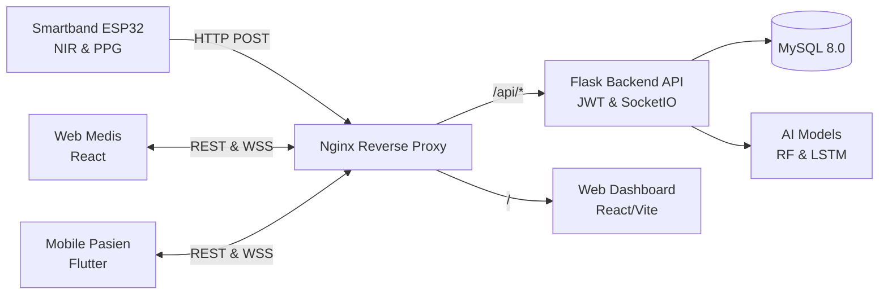

# Glucoband - Sistem Pemantauan Gula Darah Non-Invasive

Glucoband adalah platform ekosistem kesehatan IoT dan AI untuk pemantauan kadar gula darah secara **non-invasif**. Sistem mengintegrasikan gelang pintar (ESP32 dengan sensor NIR multi-spektral & PPG), aplikasi mobile pasien (Flutter), web dashboard dokter (React), serta backend (Flask) yang dilengkapi model Machine Learning (Random Forest & LSTM).

---

## 🏛 Arsitektur Sistem



### Komponen Utama
- **IoT Smartband (ESP32):** Membaca data sensor optik spektrometri NIR (610–860nm), denyut nadi (PPG), SpO2, dan suhu kulit.
- **Backend (Python Flask):** REST API, autentikasi JWT, WebSocket (Socket.IO), dan orkestrasi model AI.
- **AI Models:** 
  - *Random Forest* (`rf_diabetes.pkl`): Klasifikasi tingkat risiko diabetes.
  - *LSTM Neural Network* (`glucoband_lstm_model.h5`): Peramalan (*forecasting*) tren glukosa multi-jam.
- **Web Dashboard (React 19 + Vite):** Monitoring real-time pasien, grafik riwayat, dan input rekomendasi klinis dokter.
- **Mobile App (Flutter):** Tampilan status glukosa pasien, tren harian, notifikasi bahaya, dan tanya jawab kesehatan via Gemini AI.
- **Database (MySQL 8.0):** Penyimpanan data pengguna, telemetri sensor, riwayat prediksi, dan rekomendasi.

---

---

## 📖 Ringkasan Alur Penggunaan (Manual Book)

- **Tenaga Medis (Web Dashboard):**
  1. Login menggunakan akun dengan role `tenaga_medis`.
  2. Buka menu **Data Pasien** untuk mendaftarkan atau memantau rekam medis pasien.
  3. Akses **Realtime Monitoring** untuk melihat kadar glukosa live (status: Normal, Rendah/Hipoglikemia, atau Tinggi/Hiperglikemia).
  4. Analisis grafik prediksi tren AI (LSTM) dan kirim **Rekomendasi Medis** langsung ke aplikasi pasien.
- **Pasien (Mobile App):**
  1. Login atau register akun pasien.
  2. Kenakan gelang Glucoband (pastikan gelang terhubung ke Wi-Fi).
  3. Cek kadar gula terkini pada kartu beranda, grafik tren harian, pesan peringatan, rekomendasi dokter, serta konsultasi FAQ/Gemini AI.

---

## 📡 Daftar Endpoint API

Semua request privat wajib menyertakan header: `Authorization: Bearer <JWT_TOKEN>`.

### 1. Autentikasi (`/api/auth`)
| Method | Endpoint | Deskripsi |
| :--- | :--- | :--- |
| `POST` | `/auth/login` | Login (Email & Password), mengembalikan JWT token & info user |
| `POST` | `/auth/register/pasien` | Pendaftaran akun baru pasien |

### 2. Manajemen Pasien (`/api/patients`)
| Method | Endpoint | Role | Deskripsi |
| :--- | :--- | :--- | :--- |
| `GET` | `/patients` | Medis | Mengambil daftar semua pasien |
| `GET` | `/patients/<id>` | Medis | Detail data & parameter klinis pasien |
| `POST` | `/patients` | Medis | Menambahkan data pasien baru |
| `PUT` | `/patients/<id>` | Medis | Memperbarui profil medis pasien |
| `DELETE`| `/patients/<id>` | Medis | Menghapus data pasien |

### 3. Pengukuran Sensor & Glukosa (`/api/measurements`)
| Method | Endpoint | Deskripsi |
| :--- | :--- | :--- |
| `POST` | `/measurements` | **Ingest Data IoT ESP32** (NIR 6-ch, PPG HR/SpO2/IR, suhu, estimasi glukosa) |
| `GET` | `/measurements` | 100 riwayat pengukuran terakhir |
| `GET` | `/patients/<id>/measurements` | Riwayat pengukuran pasien tertentu (`?limit=20`) |
| `GET` | `/patients/<id>/latest` | Data pengukuran paling mutakhir pasien |

### 4. Prediksi AI & Machine Learning
| Method | Endpoint | Model | Deskripsi |
| :--- | :--- | :--- | :--- |
| `POST` | `/predict/risk` | Random Forest | Input: data klinis + glukosa. Output: level & skor risiko |
| `POST` | `/predict/trend` | LSTM | Input: `glucose_history` (min 3 titik). Output: ramalan glukosa 3–6 jam ke depan |
| `GET` | `/predictions/risk/<patient_id>` | - | Mengambil status risiko terakhir pasien |
| `GET` | `/predictions/trend/<patient_id>` | - | Mengambil ramalan tren glukosa terakhir |
| `GET` | `/predictions/trend/<patient_id>/history` | - | Riwayat prediksi tren glukosa pasien |

### 5. Rekomendasi, Notifikasi, & Lainnya
| Method | Endpoint | Role | Deskripsi |
| :--- | :--- | :--- | :--- |
| `POST` | `/patients/<id>/recommendations` | Medis | Kirim rekomendasi klinis dokter ke pasien |
| `GET` | `/patient/notifications` | Pasien | Notifikasi peringatan & rekomendasi milik pasien |
| `PUT` | `/patient/recommendations/<id>/read` | Pasien | Menandai rekomendasi telah dibaca |
| `GET` | `/notifications` | Medis | Daftar seluruh peringatan darurat pasien |
| `GET/PUT`| `/profile` | User | Mengambil atau memperbarui profil pengguna |
| `GET/POST`| `/faq` | User/Medis | Mengambil atau mengelola artikel FAQ |
| `GET` | `/dashboard/stats` | Medis | Statistik total pasien, alert hari ini, dan bacaan |

---

## 📂 Struktur Direktori Proyek

```text
glucoband/
├── backend/                  # REST API Flask & Machine Learning
│   ├── app/
│   │   ├── ml_models/        # Bobot Model (rf_diabetes.pkl, lstm_model.h5)
│   │   ├── routes/           # Controller Blueprint (auth, patients, measurements, dll)
│   │   ├── services/ml/      # Service Inferensi ML (LSTM & Random Forest)
│   │   └── __init__.py       # Factory App & Socket.IO
│   ├── backup/               # Dump SQL Database Awal
│   ├── app.py                # Entrypoint Backend Server
│   ├── db.py                 # Koneksi & Decorator Database MySQL
│   └── requirement.txt       # Dependensi Python
├── web/                      # Frontend Dashboard Tenaga Medis (React 19 + Vite)
│   ├── src/
│   │   ├── pages/            # Halaman Dashboard, Pasien, Realtime Monitoring, FAQ
│   │   ├── components/       # Komponen UI (Navbar, Sidebar, Charts)
│   │   └── api/              # Axios API Client
│   └── package.json
├── mobile/glucobandapp/      # Aplikasi Pasien (Flutter)
│   ├── lib/
│   │   ├── core/constants/   # apiConstant.dart (Base URL Server)
│   │   ├── presentation/     # UI Pages (Beranda, Monitoring, Profile, FAQ)
│   │   └── services/         # API Service, Socket, Secure Storage, Gemini AI
│   └── pubspec.yaml
├── docker-compose.yml        # Setup Kontainer MySQL
└── README.md                 # Dokumentasi Proyek
```

---

## 📄 Lisensi
MIT License © 2026 Tim Glucoband.
