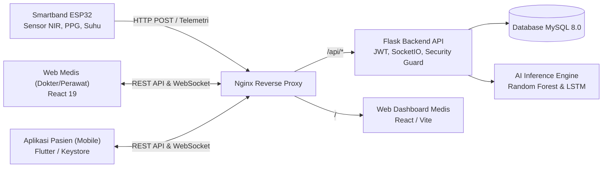

# Glucoband - Sistem Pemantauan Gula Darah Non-Invasif

Glucoband adalah platform ekosistem kesehatan berbasis Internet of Things (IoT) dan Artificial Intelligence (AI) untuk pemantauan kadar glukosa darah secara non-invasif. Sistem ini mengintegrasikan perangkat keras gelang pintar (ESP32 dengan sensor NIR multi-spektral dan PPG), aplikasi mobile pasien (Flutter), web dashboard tenaga medis (React), serta backend API (Flask) yang dilengkapi model Machine Learning (Random Forest dan LSTM) serta mekanisme keamanan tingkat lanjut.

---

## Arsitektur Sistem



### Komponen Utama
- **IoT Smartband (ESP32):** Mengukur spektrometri serapan optik NIR (610 nm hingga 860 nm), fotopletismografi (PPG untuk denyut jantung dan estimasi SpO2), serta sensor suhu inframerah non-kontak.
- **Backend Service (Python Flask):** Menyediakan REST API, otentikasi JWT, komunikasi WebSocket real-time (Flask-SocketIO), kontrol otorisasi rekam medis, dan inferensi model AI.
- **AI & Machine Learning Engine:**
  - *Random Forest Classifier* (`rf_diabetes.pkl`): Mengestimasi tingkat risiko diabetes berdasarkan parameter klinis dan profil glukosa.
  - *LSTM Neural Network* (`glucoband_lstm_model.h5`): Memprediksi tren fluktuasi kadar glukosa darah dalam rentang waktu 3 hingga 6 jam ke depan.
- **Web Dashboard (React 19 + Vite + Tailwind CSS):** Pusat monitoring real-time untuk tenaga medis, visualisasi grafik riwayat, deteksi status pasien aktif/online, dan pengiriman rekomendasi klinis.
- **Aplikasi Mobile (Flutter):** Antarmuka pasien untuk memantau kadar glukosa harian, riwayat pengukuran, penerimaan notifikasi peringatan/rekomendasi dokter, konfigurasi Wi-Fi smartband, dan asisten edukasi kesehatan berbasis Gemini AI.
- **Database (MySQL 8.0):** Penyimpanan relasional data kredensial terenkripsi, profil pasien, catatan pengukuran sensor, riwayat prediksi AI, dan pesan rekomendasi.

---

## Keamanan Sistem

Sistem Glucoband menerapkan prinsip keamanan bertingkat defense-in-depth untuk melindungi data sensitif rekam medis pasien:

1. **Enkripsi Kata Sandi:**
   - Menggunakan algoritma fungsi hash kriptografi `scrypt` via Werkzeug.
   - Dilengkapi mekanisme *transparent auto-upgrade* saat proses login berlangsung untuk memperbarui data kata sandi lama secara otomatis tanpa mengganggu kenyamanan pengguna.

2. **Validasi Kredensial & Proteksi Brute Force:**
   - Validasi ketat kata sandi minimal 8 karakter dengan kombinasi huruf dan angka pada saat registrasi maupun pembaruan data.
   - Fitur proteksi *Login Rate Limiting*: Batas maksimal 5 kali kegagalan login berturut-turut. Jika batas terlampaui, akun ditangguhkan (*lockout*) selama 5 menit dengan respons HTTP 429 Too Many Requests untuk mencegah serangan brute force dan dictionary attack.

3. **Penyimpanan Token Berbasis Hardware:**
   - Pada aplikasi mobile, token akses JWT disimpan menggunakan `FlutterSecureStorage` dengan opsi `encryptedSharedPreferences: true`.
   - Kunci enkripsi AES-256 GCM dikelola langsung oleh Android Keystore / iOS Keychain pada level sistem operasi perangkat keras, mencegah ekstraksi token melalui proses *reverse engineering* atau inspeksi data lokal.

4. **Otorisasi Rekam Medis:**
   - Setiap endpoint rekam medis, riwayat pengukuran, dan prediksi AI dilindungi oleh decorator otorisasi terpusat (`@patient_owner_or_medis` dan `@patient_body_owner_or_medis`).
   - Pasien hanya memiliki izin untuk melihat dan mengunggah data atas nama akunnya sendiri (`user_id == patient_id`). Upaya manipulasi ID pasien pada parameter URL maupun payload JSON akan langsung ditolak dengan status HTTP 403 Forbidden.
   - Evaluasi otorisasi dijalankan sebelum pembukaan koneksi database (*early rejection*) guna mencegah pemborosan resource database dari serangan scraping atau manipulasi parameter.
   - Akun dengan wewenang `tenaga_medis` memiliki izin menyeluruh untuk membaca data seluruh pasien dalam rangka observasi medis.

---

## Alur Penggunaan Sistem

### 1. Tenaga Medis (Web Dashboard)
- Melakukan login menggunakan akun berwewenang `tenaga_medis`.
- Mengakses halaman **Data Pasien** untuk mengelola profil pasien baru atau melihat riwayat klinis.
- Membuka menu **Real-time Monitoring** untuk mengamati data sensor langsung dari pasien yang sedang terhubung dan mengenakan perangkat.
- Meninjau hasil analisis grafik prediksi tren AI (LSTM) dan tingkat risiko (Random Forest).
- Mengirimkan instruksi atau **Rekomendasi Medis** langsung ke perangkat mobile pasien.

### 2. Pasien (Aplikasi Mobile)
- Mendaftar atau login ke akun pasien melalui aplikasi mobile.
- Mengonfigurasi jaringan Wi-Fi perangkat gelang melalui dialog koneksi GlucoBand.
- Memasang perangkat pada pergelangan tangan dan jari untuk memulai pengukuran.
- Melihat hasil estimasi kadar gula darah, denyut jantung, suhu kulit, serta status kesehatan (Normal, Hipoglikemia, atau Hiperglikemia).
- Menerima notifikasi darurat dan rekomendasi penanganan langsung dari tenaga medis.
- Mengakses menu edukasi dan asisten konsultasi berbasis Gemini AI.

---

## Daftar Endpoint REST API

Semua request yang membutuhkan otentikasi wajib menyertakan header HTTP:
`Authorization: Bearer <JWT_TOKEN>`

### 1. Autentikasi (`/api/auth`)
| Method | Endpoint | Akses | Deskripsi |
| :--- | :--- | :--- | :--- |
| `POST` | `/auth/login` | Publik | Otentikasi pengguna (email dan password). Dilengkapi rate limiter brute force. |
| `POST` | `/auth/register/pasien` | Publik | Registrasi akun baru pasien dengan validasi password ketat dan hashing otomatis. |

### 2. Pengukuran & Telemetri Sensor (`/api/measurements`)
| Method | Endpoint | Akses | Deskripsi |
| :--- | :--- | :--- | :--- |
| `POST` | `/measurements` | IoT / Pasien | Ingest data telemetri sensor (NIR, PPG, Suhu) dan estimasi glukosa. Dilindungi verifikasi kepemilikan payload. |
| `GET` | `/measurements` | Pasien / Medis | Mengambil riwayat pengukuran. Khusus pasien otomatis difilter hanya menampilkan data milik sendiri. |
| `GET` | `/patients/<id>/measurements` | Pemilik / Medis | Mengambil riwayat pengukuran pasien berdasarkan ID (Anti-IDOR protected). |
| `GET` | `/patients/<id>/latest` | Pemilik / Medis | Mengambil data pengukuran paling mutakhir dari pasien tertentu. |
| `POST` | `/measurements/live-stream` | Pasien | Streaming data denyut jantung dan sensor secara real-time via WebSocket. |

### 3. Prediksi AI & Machine Learning
| Method | Endpoint | Model | Deskripsi |
| :--- | :--- | :--- | :--- |
| `POST` | `/predict/risk` | Random Forest | Input: parameter klinis dan glukosa. Output: level risiko dan skor probabilitas. |
| `POST` | `/predict/trend` | LSTM | Input: riwayat glukosa historis. Output: perkiraan kurva glukosa 3 hingga 6 jam ke depan. |
| `GET` | `/predictions/risk/<patient_id>` | - | Mengambil hasil evaluasi risiko diabetes pasien (Anti-IDOR protected). |
| `GET` | `/predictions/trend/<patient_id>` | - | Mengambil data tren prediksi glukosa terkini pasien (Anti-IDOR protected). |
| `GET` | `/predictions/trend/<patient_id>/history` | - | Mengambil riwayat seluruh prediksi tren glukosa pasien (Anti-IDOR protected). |
| `DELETE`| `/predictions/trend/<prediction_id>` | Pemilik / Medis | Menghapus satu entri riwayat prediksi tren glukosa. |

### 4. Manajemen Pasien (`/api/patients`)
| Method | Endpoint | Akses | Deskripsi |
| :--- | :--- | :--- | :--- |
| `GET` | `/patients` | Medis | Mengambil seluruh daftar pasien terdaftar. |
| `GET` | `/patients/<id>` | Medis | Mengambil rincian data klinis pasien berdasarkan ID. |
| `POST` | `/patients` | Medis | Mendaftarkan pasien baru ke dalam database. |
| `PUT` | `/patients/<id>` | Medis | Memperbarui informasi profil atau riwayat medis pasien. |
| `DELETE`| `/patients/<id>` | Medis | Menghapus data akun pasien dari sistem. |
| `GET` | `/patients/online` | Medis | Mengambil daftar ID pasien yang sedang aktif/terkoneksi WebSocket. |

### 5. Notifikasi, Rekomendasi, & Profil
| Method | Endpoint | Akses | Deskripsi |
| :--- | :--- | :--- | :--- |
| `GET` | `/notifications` | Medis | Mengambil seluruh daftar peringatan kondisi darurat pasien secara global. |
| `POST` | `/patients/<id>/recommendations` | Medis | Mengirimkan catatan rekomendasi klinis dari dokter ke akun pasien terkait. |
| `GET` | `/patient/notifications` | Pasien | Mengambil riwayat notifikasi peringatan dan rekomendasi milik akun pasien aktif. |
| `PUT` | `/patient/recommendations/<id>/read` | Pasien | Menandai rekomendasi medis tertentu telah dibaca oleh pasien. |
| `GET` | `/profile` | Pengguna | Mengambil profil pengguna yang sedang login. |
| `PUT` | `/profile` | Pengguna | Memperbarui parameter kesehatan mandiri (tinggi, berat badan, tekanan darah). |
| `GET` | `/dashboard/stats` | Medis | Mengambil ringkasan statistik total pasien, alert hari ini, dan jumlah pengukuran. |
| `GET/POST`| `/faq` | Pengguna / Medis | Mengambil daftar artikel FAQ atau mengunggah konten tanya-jawab baru. |

---

## Struktur Direktori Proyek

```text
glucoband/
|-- backend/
|   |-- app/
|   |   |-- ml_models/            # File bobot model machine learning (pkl dan h5)
|   |   |-- routes/               # Handler endpoint API (auth, measurements, patients, dll)
|   |   |-- services/ml/          # Service inferensi model LSTM dan Random Forest
|   |   |-- utils/                # Helper keamanan (decorators.py, validators.py)
|   |   `-- __init__.py           # Inisialisasi aplikasi Flask dan Socket.IO
|   |-- backup/                   # Skrip dump struktur awal basis data SQL
|   |-- app.py                    # Entry point server backend Flask
|   |-- config.py                 # Konfigurasi aplikasi dan variabel lingkungan
|   |-- db.py                     # Manajemen koneksi basis data MySQL
|   `-- requirement.txt           # Daftar dependensi library Python
|-- web/
|   |-- src/
|   |   |-- api/                  # Axios HTTP client terkonfigurasi
|   |   |-- components/           # Komponen antarmuka (Navbar, Sidebar, Charts, Gauges)
|   |   |-- pages/                # Halaman Web (Monitoring, Pasien, Pengaturan, Login)
|   |   `-- App.jsx               # Routing utama aplikasi web
|   |-- index.html
|   `-- package.json              # Dependensi JavaScript / React
|-- mobile/glucobandapp/
|   |-- android/                  # Konfigurasi native Android
|   |-- lib/
|   |   |-- core/constants/       # URL API dan konfigurasi konstanta
|   |   |-- data/datasources/     # Sumber data lokal dan Keystore
|   |   |-- presentation/         # Tampilan UI Flutter (Beranda, Monitoring, Dialog)
|   |   `-- services/             # Service API, Secure Storage, WebSocket, dan Gemini
|   `-- pubspec.yaml              # Dependensi Flutter
|-- Glucoband-Firmware-master/    # Source code firmware mikroprosesor ESP32
|-- docker-compose.yml            # Konfigurasi kontainer basis data MySQL
`-- README.md                     # Dokumentasi teknis proyek
```
