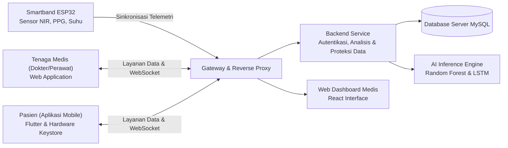

# Glucoband - Sistem Pemantauan Gula Darah Non-Invasif

Glucoband adalah platform ekosistem kesehatan berbasis Internet of Things (IoT) dan Artificial Intelligence (AI) untuk pemantauan kadar glukosa darah secara non-invasif. Sistem ini mengintegrasikan perangkat keras gelang pintar (ESP32 dengan sensor NIR multi-spektral dan PPG), aplikasi mobile pasien (Flutter), web dashboard tenaga medis (React), serta backend service (Flask) yang dilengkapi model Machine Learning (Random Forest dan LSTM) serta mekanisme keamanan tingkat lanjut.

---

## Arsitektur Sistem



### Komponen Utama
- **IoT Smartband (ESP32 / ESP32-C3):** Membaca data spektrometri serapan optik NIR (610 nm hingga 860 nm), fotopletismografi (PPG untuk denyut nadi dan estimasi SpO2), serta sensor suhu inframerah non-kontak.
- **Backend Service (Python Flask):** Mengelola logika bisnis, autentikasi sesi, komunikasi real-time terenkripsi, kontrol otorisasi rekam medis, dan orkestrasi model inferensi AI.
- **AI & Machine Learning Engine:**
  - *Random Forest Classifier*: Mengestimasi tingkat risiko diabetes berdasarkan parameter klinis dan profil glukosa.
  - *LSTM Neural Network*: Memproyeksikan tren fluktuasi kadar glukosa darah dalam rentang waktu beberapa jam ke depan berdasarkan data historis.
- **Web Dashboard (React + Tailwind CSS):** Pusat observasi untuk tenaga medis guna memantau data pasien aktif, menganalisis grafik tren kesehatan, dan mengirimkan rekomendasi klinis.
- **Aplikasi Mobile (Flutter):** Antarmuka pasien untuk memantau status glukosa harian, riwayat pengukuran, penerimaan notifikasi medis, konfigurasi jaringan perangkat, dan asisten edukasi kesehatan berbasis Gemini AI.
- **Database (MySQL):** Penyimpanan relasional untuk profil pengguna terenkripsi, catatan sensor telemetri, riwayat proyeksi AI, dan pesan rekomendasi klinis.

---

## Firmware & Perangkat Keras IoT (Glucoband-Firmware-master)

Firmware gelang pintar GlucoBand dikembangkan menggunakan framework Arduino untuk mikrokontroler ESP32/ESP32-C3 dengan arsitektur pembacaan sensor non-invasif yang efisien dan modular.

### 1. Spesifikasi Sensor & Perangkat Keras
- **Mikrokontroler Utama:** ESP32 / ESP32-C3 berbasis arsitektur 32-bit dengan modul Wi-Fi dan Bluetooth bawaan.
- **Sensor Spektrometri Multi-Spektral (AS726X):**
  - Mengukur tingkat penyerapan cahaya inframerah dekat (*Near-Infrared / NIR*) pada 6 saluran panjang gelombang: R (610 nm), S (680 nm), T (730 nm), U (760 nm), V (810 nm), dan W (860 nm).
  - Dilengkapi otomatisasi lampu pemancar (*built-in illumination bulb*) yang hanya aktif saat jari terdeteksi untuk efisiensi daya dan stabilitas optik.
- **Sensor Fotopletismografi (MAX30105):**
  - Mengukur sinyal pulsa denyut nadi (*Photoplethysmography / PPG*) melalui LED inframerah dan merah.
  - Mendeteksi keberadaan jari (*finger presence detection*) berdasarkan ambang batas pantulan inframerah (*IR Value > 30.000*) serta menghitung rata-rata denyut jantung per menit (BPM).
- **Sensor Suhu Inframerah Non-Kontak (MLX90614):**
  - Mengukur suhu objek/kulit (*skin temperature*) dan suhu ambien lingkungan secara presisi tanpa sentuhan fisik langsung.
- **Layar Tampilan Lokal (OLED SSD1306 128x32 piksel, I2C 0x3C):**
  - Menampilkan umpan balik visual dua halaman (*dual-page display*):
    - Mode Standby: Menampilkan petunjuk peletakan jari, status koneksi Wi-Fi, SSID, alamat IP perangkat, serta jumlah smartphone yang terhubung.
    - Mode Pengukuran: Menampilkan pembacaan denyut jantung real-time, suhu tubuh, dan nilai spektrum 6 kanal NIR.

### 2. Konfigurasi Antarmuka Bus I2C
Seluruh sensor dan layar berkomunikasi melalui jalur komunikasi bersama I2C (*Inter-Integrated Circuit*) standar:
- **Jalur Data (SDA):** GPIO 8
- **Jalur Jam (SCL):** GPIO 9
- **Kecepatan Bus:** 100 kHz (I2C Standard Mode)
- **Batas Waktu (*Timeout*):** 50 ms untuk mencegah *bus lock-up* bila terdapat sensor yang belum terpasang.

### 3. Sistem Jaringan & Portal Konfigurasi Mandiri (WiFiConfig)
Modul `WiFiConfig` menangani konektivitas jaringan secara mandiri tanpa memerlukan pengaturan ulang kode sumber (*hardcoded*):
- **Mode Access Point Darurat (SoftAP):**
  - Memancarkan sinyal Wi-Fi mandiri dengan SSID `GlucoBand-Setup` (tanpa kata sandi) dan IP gateway default `192.168.4.1`.
  - Mengaktifkan transmisi radio pada kekuatan maksimal (+19.5 dBm) dan menonaktifkan *sleep mode* agar sinyal Wi-Fi mudah ditangkap oleh ponsel pintar.
- **Penyimpanan Kredensial Permanen (Non-Volatile Storage / NVS):**
  - Menggunakan modul `Preferences` ESP32 untuk menyimpan SSID dan kata sandi router pengguna secara permanen pada memori *flash*. Kredensial tetap tersimpan meski perangkat dimatikan atau kehabisan daya.
- **Pemulihan Koneksi Otomatis (*Fail-Safe Reconnect*):**
  - Perangkat secara otomatis mencoba menyambung ke jaringan router yang tersimpan saat pertama kali dinyalakan.
  - Jika router tidak terjangkau atau gagal tersambung setelah 2 kali percobaan, sistem secara otomatis beralih ke mode SoftAP murni agar pengguna dapat melakukan konfigurasi ulang melalui aplikasi mobile.
- **Web Server & API Lokal Terintegrasi:**
  - Menyediakan layanan HTTP internal pada porta 80 yang mendukung mekanisme *Captive Portal* peramban serta integrasi langsung dengan aplikasi Flutter melalui endpoint API lokal untuk membaca status sensor secara real-time.

---

## Standar Keamanan Sistem

Sistem Glucoband menerapkan prinsip keamanan bertingkat (*defense-in-depth*) untuk menjamin kerahasiaan dan integritas data medis:

1. **Enkripsi Kata Sandi (Password Hashing):**
   - Menggunakan algoritma fungsi hash kriptografi `scrypt` via Werkzeug.
   - Dilengkapi mekanisme pembaruan otomatis (*transparent auto-upgrade*) saat otentikasi berlangsung untuk memperbarui kredensial secara aman.

2. **Validasi Kredensial & Proteksi Brute Force:**
   - Standar kompleksitas kata sandi minimal 8 karakter dengan kombinasi karakter alfanumerik.
   - Mekanisme pembatasan percobaan login (*Rate Limiting*): Membatasi upaya otentikasi gagal berturut-turut untuk melindungi akun dari serangan brute force dan dictionary attack.

3. **Penyimpanan Kredensial Aman Berbasis Hardware:**
   - Pada aplikasi mobile, token sesi disimpan menggunakan media penyimpanan terenkripsi yang terikat pada Android Keystore atau iOS Keychain.
   - Kunci enkripsi AES-256 GCM dikelola langsung pada level sistem operasi perangkat keras sehingga terlindung dari akses aplikasi lain atau inspeksi memori lokal.

4. **Kontrol Akses Rekam Medis (Anti-IDOR):**
   - Akses data rekam medis diproteksi dengan otorisasi berbasis peran dan kepemilikan data.
   - Akun pasien dibatasi secara ketat sehingga hanya dapat mengakses dan memperbarui informasi miliknya sendiri. Permintaan data milik pengguna lain dicegat dan ditolak secara otomatis oleh layer keamanan backend.
   - Validasi otorisasi dieksekusi secara dini (*early rejection*) sebelum pemrosesan query database untuk mengoptimalkan kinerja dan menjaga ketahanan server.
   - Tenaga medis memiliki wewenang observasi menyeluruh terhadap data pasien yang terdaftar dalam naungan fasilitas kesehatan.

---

## Alur Penggunaan Sistem

### 1. Tenaga Medis (Web Dashboard)
- Masuk ke portal web menggunakan akun tenaga medis terverifikasi.
- Mengelola data demografis dan parameter klinis pasien pada menu manajemen pasien.
- Mengamati indikator kesehatan dan data telemetri langsung pada modul monitoring real-time saat pasien terhubung.
- Meninjau evaluasi risiko dan kurva proyeksi glukosa hasil analisis model AI.
- Mengirimkan arahan medis atau rekomendasi pola hidup secara terarah ke aplikasi pasien.

### 2. Pasien (Aplikasi Mobile & Gelang Pintar)
- Masuk ke akun pasien pada aplikasi mobile.
- Menghubungkan perangkat gelang pintar ke jaringan Wi-Fi rumah atau kantor melalui dialog panduan koneksi GlucoBand.
- Memasang gelang pada pergelangan tangan dan menempelkan jari pada sensor optik untuk memulai pengukuran biometrik.
- Memantau estimasi kadar glukosa darah, denyut jantung, suhu kulit, serta status kesehatan secara mandiri.
- Menerima pesan peringatan dini serta rekomendasi medis yang dikirimkan oleh dokter secara real-time.
- Berkonsultasi terkait edukasi kesehatan melalui fitur asisten cerdas berbasis Gemini AI.

---

## Modul Layanan Sistem

Sistem backend mengintegrasikan beberapa modul layanan fungsional:

1. **Layanan Manajemen Akses & Keamanan:**
   Mengatur registrasi pasien, proses otentikasi multi-peran, verifikasi token sesi, dan penegakan pembatasan frekuensi percobaan masuk.

2. **Layanan Telemetri Sensor & Pengukuran:**
   Menangani penerimaan data spektrum NIR multi-panjang gelombang, sinyal PPG, dan suhu tubuh dari perangkat pintar, serta menyaring riwayat pengukuran sesuai hak akses pengguna.

3. **Layanan Inferensi Kecerdasan Buatan:**
   Menghubungkan data sensor dan profil klinis dengan model Machine Learning untuk klasifikasi risiko diabetes serta peramalan tren glukosa darah.

4. **Layanan Komunikasi Real-time & Notifikasi:**
   Memfasilitasi streaming data biometrik secara langsung ke dashboard medis dan mendistribusikan notifikasi darurat serta rekomendasi klinis ke aplikasi mobile.

5. **Layanan Manajemen Pasien & Rekam Medis:**
   Menyediakan fungsi pencatatan dan pembaruan profil klinis bagi tenaga medis, pengaturan parameter kesehatan, serta integrasi edukasi kesehatan.

---

## Struktur Direktori Proyek

```text
glucoband/
|-- backend/
|   |-- app/
|   |   |-- ml_models/            # Model machine learning terkompilasi
|   |   |-- routes/               # Modul logika layanan backend
|   |   |-- services/ml/          # Layanan inferensi model AI
|   |   |-- utils/                # Utilitas keamanan, otorisasi, dan validasi
|   |   `-- __init__.py           # Konfigurasi layanan backend dan socket
|   |-- backup/                   # Skrip inisialisasi basis data
|   |-- app.py                    # Berkas utama eksekusi backend
|   |-- config.py                 # Konfigurasi aplikasi
|   |-- db.py                     # Pengelola koneksi basis data
|   `-- requirement.txt           # Dependensi pustaka Python
|-- web/
|   |-- src/
|   |   |-- api/                  # Klien komunikasi layanan web
|   |   |-- components/           # Komponen antarmuka pengguna
|   |   |-- pages/                # Modul halaman web dashboard
|   |   `-- App.jsx               # Pengatur navigasi web
|   |-- index.html
|   `-- package.json              # Dependensi pustaka antarmuka web
|-- mobile/glucobandapp/
|   |-- android/                  # Konfigurasi platform Android
|   |-- lib/
|   |   |-- core/constants/       # Konfigurasi konstanta aplikasi
|   |   |-- data/datasources/     # Sumber data lokal dan Keystore
|   |   |-- presentation/         # Modul antarmuka aplikasi Flutter
|   |   `-- services/             # Layanan penyimpanan aman, jaringan, dan AI
|   `-- pubspec.yaml              # Dependensi pustaka Flutter
|-- Glucoband-Firmware-master/    # Firmware mikrokontroler ESP32
|   `-- glucoband/
|       |-- glucoband.ino         # Berkas utama program mikrokontroler (setup & loop)
|       |-- WiFiConfig.cpp        # Logika konektivitas Wi-Fi, Web Server, dan SoftAP
|       |-- WiFiConfig.h          # Header pustaka manajemen Wi-Fi
|       |-- startup.cpp           # Animasi grafis awal dan ikon layar OLED
|       `-- startup.h             # Header animasi grafis
|-- docker-compose.yml            # Konfigurasi kontainer basis data
`-- README.md                     # Dokumentasi teknis proyek
```
